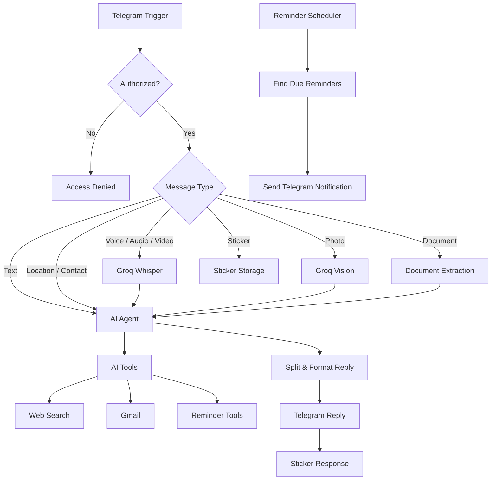

# 🤖 AuraTaskx — Telegram Personal AI Assistant

> Your personal AI assistant on Telegram — powered by n8n automation.

AuraTaskx is an AI-powered personal assistant that lives inside Telegram. Send text, voice notes, photos, documents, stickers, locations, or contacts, and it responds like a friendly assistant.

It can also search the web, read and send Gmail messages, analyze documents, and manage reminders — all through natural language.

Built as a single importable **n8n workflow**, AuraTaskx requires no separate application server or custom code deployment.

---

## 🎬 Demo Video

The demo video is included in this repository.

**▶️ [Watch AuraTaskx Demo](./assets/AuraTaskx-Demo.mp4)**

> Add your video to the `assets` folder using the filename `AuraTaskx-Demo.mp4`. If your video has a different filename, update the path above.

---

## 📦 Workflow

The complete n8n workflow template is included in this repository.

**[⬇️ Download AuraTaskx Workflow](./AuraTaskx_template.json)**

Import `AuraTaskx_template.json` into n8n to get started. Configure your own credentials, Telegram user ID, and reminder webhook settings before activating it.

---

## ✨ Features

| Feature | Description |
|---|---|
| 💬 AI Chat | Natural conversations with per-chat memory and multilingual replies. |
| 🎙️ Voice & Audio | Transcribes voice notes and audio using Groq Whisper. |
| 🎥 Video | Extracts and understands spoken content from video (speech only, not frames). |
| 🖼️ Image Analysis | Understands photos, reads visible text, and answers image-related questions using vision AI. |
| 📄 Document Assistant | Reads and summarizes PDF, DOCX, PPTX, Excel/ODS, and text/code formats. |
| 🌐 Web Search | Searches the web for current news, prices, weather, scores, and more via SerpAPI. |
| 📧 Gmail | Reads emails, checks unread messages, and sends emails on request. |
| ⏰ Reminders | Creates, lists, and cancels reminders using natural language. |
| 📍 Locations | Processes shared locations and provides map links. |
| 👤 Contacts | Understands shared Telegram contact cards. |
| 🎭 Stickers | Learns stickers sent to it and can use them in replies. |
| 🔐 Access Control | Restricts usage to whitelisted Telegram user IDs. |
| 🛡️ Safety | Guardrails against prompt injection in external content and refuses pirated-download requests. |

---

## 🧠 Workflow



### Message Handling

- **Text:** Sent directly to the AI Agent.
- **Voice, audio, and video:** Speech is transcribed using Groq Whisper.
- **Photos:** Analyzed by a Groq vision model.
- **Documents:** Classified and processed with the appropriate extraction method.
- **Locations and contacts:** Parsed into structured information.
- **Stickers:** Stored for future use.

The AI Agent can use Web Search, Gmail, and Reminder tools as needed.

---

## 🛠️ Tech Stack

- **Workflow Automation:** n8n
- **Messaging:** Telegram Bot API
- **AI Chat:** Groq API
- **Speech-to-Text:** Groq Whisper (`whisper-large-v3-turbo`)
- **Vision:** Groq vision model
- **Web Search:** SerpAPI
- **Email:** Gmail API / OAuth2
- **Logic & Processing:** JavaScript

**Default chat model:** `openai/gpt-oss-120b`

---

## 📋 Requirements

Before installing, prepare:

- An n8n instance (cloud or self-hosted)
- A publicly accessible HTTPS URL for n8n
- Telegram bot token from [@BotFather](https://t.me/BotFather)
- Groq API key from [Groq Console](https://console.groq.com/)
- Gmail account connected through Google OAuth2 in n8n
- SerpAPI key from [SerpAPI](https://serpapi.com/)

---

## 🚀 Setup

### 1. Import the Workflow

1. Open your n8n dashboard.
2. Go to **Workflows → Import from File**.
3. Import `AuraTaskx_template.json`.

### 2. Configure Credentials

Create credentials in n8n and assign them to the relevant nodes:

| Credential | Nodes |
|---|---|
| Telegram API | Telegram trigger, reply, file, and sticker nodes |
| Groq API | Groq Chat Model, Transcribe Voice, Groq Vision |
| Gmail OAuth2 | Read Emails, Send Email |
| SerpAPI | Web Search |

### 3. Whitelist Your Telegram Account

Open the **Is Authorized?** node and replace:

```text
YOUR_TELEGRAM_USER_ID
```

with your numeric Telegram user ID.

To allow multiple users, use comma-separated IDs:

```text
111111111,222222222
```

If you don't know your Telegram ID, leave the placeholder, message your bot, and the access-denied response will show your ID.

### 4. Configure the Reminder Webhook

In the **Set Reminder**, **List Reminders**, and **Cancel Reminder** nodes:

- Replace `YOUR-N8N-DOMAIN` with your n8n domain.
- Replace `CHANGE-ME` with a secure random string.
- Make sure the webhook path and all three reminder tool URLs match exactly.

> ⚠️ The reminder webhook uses its secret path as protection. Keep it private.

### 5. Set Your Timezone

Default timezone:

```text
Asia/Kolkata (UTC+05:30)
```

To change it, update the timezone expressions and examples in the AI Agent system prompt, the Set Reminder tool description, and `TZ_OFFSET_MIN` in the Reminder Store node.

### 6. Activate

Save and activate the workflow. Open your Telegram bot and start chatting.

---

## 💬 Example Prompts

| Use Case | Example |
|---|---|
| Document | “Summarize this PDF.” |
| Image | “What does this sign say?” (send a photo) |
| Voice | Send a voice note asking a question. |
| Reminder | “Remind me to submit the report tomorrow at 10 AM.” |
| Gmail | “Check my unread emails from today.” |
| Email | “Send an email thanking them for the meeting.” |
| Web Search | “What’s the latest news about cricket?” |
| List Reminders | “Show my reminders.” |
| Cancel Reminder | “Cancel the reminder about the report.” |

---

## ⚙️ Customization

| Setting | Node |
|---|---|
| Assistant personality and instructions | AI Agent → System Message |
| Chat model | Groq Chat Model |
| Vision model | Groq Vision → model parameter |
| Transcription model | Transcribe Voice → model parameter |
| Document character limit | Build Document Input → `MAX_CHARS` |
| Sticker probability | Split Reply & Sticker → `CHANCE` |
| Memory length | Chat Memory → Context Window Length |

Check [Groq's model documentation](https://console.groq.com/docs/models) for current model availability.

---

## ⚠️ Limitations

- Telegram bots can download files up to **20 MB**.
- Scanned or image-only PDFs are not OCR-processed.
- Legacy `.doc` and `.ppt` formats are not supported.
- Long documents may be truncated before being sent to the AI.
- Chat memory is in-memory and resets when n8n restarts.
- Reminders and sticker data are stored in workflow static data.
- Reminder notifications may be delayed by up to approximately one minute.
- The bot can only send stickers it has previously received.

---

## 🔐 Security Notes

- Never commit API keys, Telegram bot tokens, user IDs, or reminder webhook secrets.
- Keep the Telegram authorization check enabled.
- Store credentials in n8n credential storage, not in the exported workflow.
- If a token is exposed, revoke it immediately through its provider.
- Remove personal IDs, webhook paths, credential blocks, `webhookId` values, and `instanceId` before sharing workflow exports.

---

## 🤝 Contributing

Contributions, bug reports, ideas, and pull requests are welcome.

1. Fork the repository.
2. Create a branch for your changes.
3. Commit your improvements.
4. Open a pull request.

---

## 📜 License

This project is licensed under the **MIT License**. See the [LICENSE](./LICENSE) file for details.

---

## 🙌 Acknowledgements

Built with:

- [n8n](https://n8n.io/)
- [Telegram Bot API](https://core.telegram.org/bots/api)
- [Groq](https://groq.com/)
- [SerpAPI](https://serpapi.com/)

---

<p align="center">
  <b>🤖 AuraTaskx — Your AI assistant, right inside Telegram.</b>
</p>
